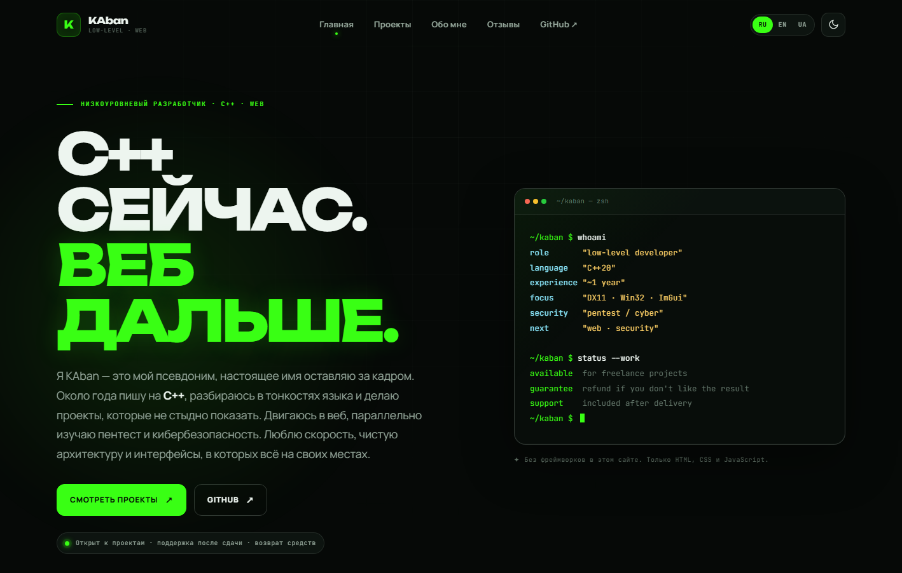

<div align="center">
  
  <h1>KAban — Portfolio</h1>
  <p><strong>low-level · web</strong><br>C++ / DirectX 11 / vanilla web</p>
  <p>
    
    
    
    
    
    
    
  </p>
  <p>
    <a href="https://github.com/KAban24">GitHub</a> ·
    <a href="https://t.me/kaban2402">Telegram</a> ·
    <a href="https://github.com/KAban24?tab=repositories">Repositories</a>
  </p>
</div>

<p align="center">
  
</p>

## О проекте

Личное портфолио KAban: кейсы проектов, путь в разработке и живая система отзывов. Фронтенд собран без фреймворков и сборщиков — только HTML, CSS и JavaScript. Сервер отзывов работает на Node.js без внешних зависимостей.

Проект про низкий уровень и веб одновременно: C++20, DirectX 11, Win32, Dear ImGui, пентест и аккуратные интерфейсы, в которых всё на своих местах.

## Что внутри

- Адаптивный сайт для desktop и mobile.
- Три языка: русский, английский, украинский.
- Тёмная и светлая темы с сохранением выбора.
- Страницы проектов: GRaO.mc, Cyber Snake DX, BestPad и gostEvent_plagin.
- Отзывы с оценкой 0–5, описанием, плюсами и минусами.
- Публичные ответы на отзывы.
- Почта для связи: обязательна при отправке, но никогда не публикуется.
- API отзывов с JSON-хранилищем, rate limit и honeypot.
- Local fallback: если API недоступен, отзывы и ответы сохраняются в браузере.
- Никаких npm-зависимостей и шага сборки.

## Стек

| Слой | Технологии |
| --- | --- |
| Frontend | HTML5, CSS3, vanilla JavaScript |
| Локализация | Собственный словарь RU / EN / UK |
| Backend | Node.js 18+, встроенные `http`, `fs`, `crypto` |
| Хранилище | JSON-файл `data/reviews.json` |
| Шрифты | Google Fonts: Unbounded, Manrope, JetBrains Mono |
| Сборка | Не требуется |

## Быстрый старт

Нужен Node.js 18 или новее.

```bash
git clone https://github.com/KAban24/portfolio.git
cd portfolio
npm start
```

Открой [http://localhost:3000](http://localhost:3000).

Без npm-скрипта:

```bash
node server.js
```

Порт можно переопределить:

```bash
PORT=8080 npm start
```

В PowerShell:

```powershell
$env:PORT=8080; npm start
```

Файл `data/reviews.json` создаётся автоматически при первом отзыве. Отдельная установка зависимостей не нужна.

## Отзывы и API

Публичные эндпоинты:

| Метод | Путь | Назначение |
| --- | --- | --- |
| `GET` | `/api/reviews` | Список отзывов и ответов |
| `POST` | `/api/reviews` | Новый отзыв |
| `POST` | `/api/reviews/:id/replies` | Ответ на отзыв |

Новый отзыв принимает `name`, `email`, `rating`, `description`, `pros`, `cons`. Ответ принимает `name` и `text`.

Почта хранится только на сервере в `data/reviews.json` и вырезается из всех публичных ответов API. Автоматические письма не отправляются: почта нужна для ручной связи по отзыву.

Сейчас ответы публичные — их может оставить любой посетитель. Отдельной админки и модерации нет. Если нужен режим «отвечает только владелец», это следующий логичный шаг.

### Local fallback

При открытии сайта как статики или при недоступном API отзывы сохраняются в `localStorage` браузера. Это удобно для демо, но такие отзывы не видны другим людям. Для общих отзывов нужен Node-сервер с постоянным диском.

## Структура проекта

```text
portfolio/
├─ index.html
├─ projects.html
├─ about.html
├─ reviews.html
├─ minesweeper.html
├─ snake.html
├─ bestpad.html
├─ assets/
│  ├─ css/style.css
│  ├─ img/favicon.svg
│  └─ js/
│     ├─ app.js
│     ├─ i18n.js
│     ├─ reviews.js
│     └─ theme-init.js
├─ data/
│  └─ reviews.json
├─ docs/
│  └─ preview.png
├─ server.js
├─ package.json
├─ LICENSE
└─ .gitignore
```

`data/reviews.json` исключён из git: отзывы и почта не должны попадать в публичный репозиторий. Сервер создаёт файл сам.

## Деплой

Подходит любой Node.js-хостинг: Render, Railway, Fly.io, VPS или собственный сервер.

- Start command: `npm start`
- Node.js: `18+`
- Порт: переменная окружения `PORT`
- Для сохранения отзывов нужен постоянный диск, примонтированный к `data/`
- Для HTTPS лучше поставить reverse proxy: Caddy, Nginx или Cloudflare

На GitHub Pages, Netlify и других статических хостингах сайт тоже откроется, но отзывы будут работать в локальном режиме.

Перед публикацией:

1. Проверь контакты и ссылки на проекты.
2. Настрой постоянное хранилище для `data/reviews.json`.
3. Сделай бэкап файла отзывов.
4. Сохрани `LICENSE` при распространении проекта.
5. Включи HTTPS.

## Настройка

- Тексты и переводы: `assets/js/i18n.js`
- Цвета и темы: переменные `:root` и `[data-theme="light"]` в `assets/css/style.css`
- Проекты и контакты: соответствующие HTML-страницы
- Лимиты и параметры API: константы в начале `server.js`
- Список языков: массив `supported` в `assets/js/app.js` и `assets/js/reviews.js`

## Безопасность и приватность

- Почта не возвращается публичным API.
- Ограничение длины полей и размера запроса.
- Rate limit: 10 действий за 10 минут с одного IP.
- Honeypot-поле против простых ботов.
- Защита статики от path traversal.
- `server.js` и каталог `data/` не отдаются как статические файлы.
- Публичные отзывы и ответы рендерятся через `textContent`, без вставки HTML.

## Идеи для развития

- Админ-панель и модерация отзывов.
- Ответы только от владельца сайта.
- Email-уведомления о новых отзывах.
- Пагинация и сортировка отзывов.
- Экспорт отзывов в CSV или JSON.

## Лицензия

Проект распространяется по [Apache License 2.0](LICENSE).

Copyright 2026 KAban.

## Контакты

- GitHub: [KAban24](https://github.com/KAban24)
- Telegram: [@kaban2402](https://t.me/kaban2402)
- Discord: `kaban2402`

---

<p align="center">
  Сделано руками: HTML, CSS, JavaScript и немного C++.
</p>
